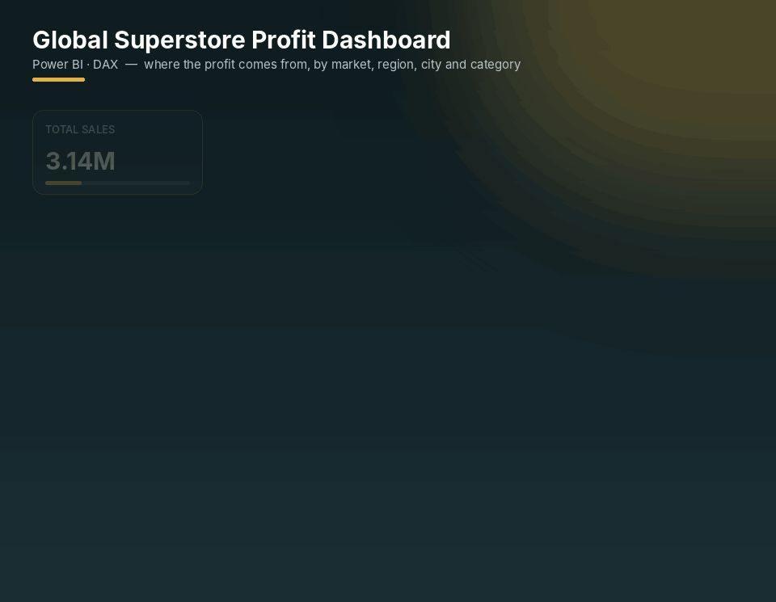
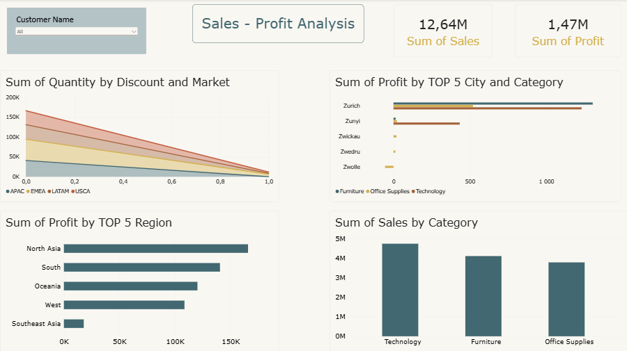

# 🌍 Global Superstore Profit Dashboard

  

*Where does the profit come from? An interactive view of profit by market, region, city, category and customer.*

## 📸 Dashboard

🔍 View full-resolution static screenshot

 

---

## ❓ Business questions

- Which regions and cities are the most profitable?
- Which product categories drive profit in the top cities?
- Which product categories generate the most sales?
- How do discounts affect profitability over time?

## 🗂 Data

Global Superstore orders data — **market, region, city, customer, category, sales, quantity, discount, profit**.

## 📊 What's inside

- **KPI cards** — total sales and total profit
- **Sum of Quantity by Discount and Market** — stacked area chart (APAC, EMEA, LATAM, USCA)
- **Sum of Profit by Top 5 Cities and Category**
- **Sum of Profit by Top 5 Regions**
- **Sum of Sales by Category**
- **Customer Name slicer** to analyse any individual customer

## 🔢 Headline KPIs

| Total sales | Total profit | Profit margin |
|:-:|:-:|:-:|
| **12.64M** | **1.47M** | **≈11.6%** |

## 💡 Key insights

- **Technology** is the top-selling category, ahead of Furniture and Office Supplies.
- **North Asia** is the most profitable region, followed by South and Oceania; **Southeast Asia** lags far behind.
- Higher discounts sharply reduce quantity sold in every market — the volume effect of discounting fades as discounts approach 100%.
- At city level, **Zurich** stands out with strong Furniture and Technology profit, while some cities show **negative profit** in Office Supplies.

## 🧠 Skills demonstrated

- Top-N analysis with DAX
- Profitability analysis across multiple dimensions
- Interactive filtering with slicers

---

## 🚀 How to open

1. Install [Power BI Desktop](https://www.microsoft.com/power-platform/products/power-bi/desktop) (free).
2. Download **`global-superstore-profit-dashboard.pbix`** from this repository.
3. Open it in Power BI Desktop and interact with the slicers and visuals.

---

Built by <a href="https://github.com/Ali-Isa-Ashrafli"><b>Ali Isa Ashrafli</b></a> · Data Analyst · Baku, Azerbaijan 
⭐ If you find this project useful, consider giving it a star!

